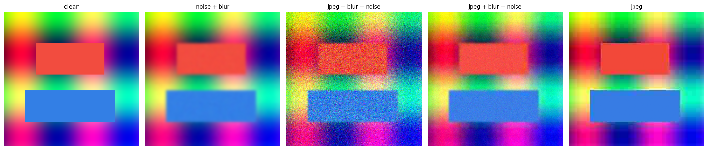

# Blind Image Restoration via Conditional Diffusion

A single diffusion model that restores images degraded by an **unknown mixture** of Gaussian blur, additive noise, and JPEG compression — no degradation label is given at inference. Trained on DIV2K and evaluated per-degradation against classical baselines (PSNR / SSIM / LPIPS).

Most restoration models target one corruption type. This project trains one *blind* model across a randomized degradation space and reports where it wins and where classical methods still hold up.

---

## Approach

A denoising U-Net is conditioned on the degraded image and learns to reverse a fixed Gaussian forward process applied to the *clean* target (SR3 / Palette-style conditioning).

```
forward:   q(x_t | x_0) = N( sqrt(ᾱ_t)·x_0 , (1−ᾱ_t)·I )
input:     [ x_t  ‖  degraded ]   (6 channels)
predict:   ε  (the noise)
sample:    x_T ~ N(0,I)  →  iterative DDIM/DDPM denoising conditioned on degraded
```

Key components:

- **Blind degradation synthesis** (`src/degradations.py`) — randomized chain of blur / noise / JPEG with per-image sampled parameters and order, generated on the fly so the effective dataset is unbounded.
- **Conditional DDPM** (`src/diffusion.py`) — cosine/linear schedules, `q_sample`, ancestral DDPM sampling, and fast DDIM sampling.
- **U-Net backbone** (`src/model.py`) — diffusers `UNet2DModel`, trainable from scratch or fine-tuned from a pretrained DDPM prior via first-conv channel expansion; EMA weights.
- **Metrics** (`src/metrics.py`) — numpy PSNR/SSIM + optional LPIPS.
- **Classical baselines** (`src/baselines.py`) — non-local means, Wiener deconvolution, bilateral, and a composite blind pipeline.

## Degradation space

| Type | Range |
|---|---|
| Gaussian blur | σ ∈ [0.5, 3.0] |
| Gaussian noise | σ ∈ [5, 50] (0–255 scale) |
| JPEG | quality ∈ [10, 60] |

Each image gets a random subset, in random order, with at least one degradation applied.



## Results

Evaluated on DIV2K validation, 256×256, per fixed degradation bucket. *(Populate after your training run — `evaluate.py` writes this table to `results/results.md`.)*

### PSNR (dB) — higher is better

| Method | noise_25 | noise_50 | blur_2.0 | jpeg_20 | jpeg_40 | mixed |
|---|---|---|---|---|---|---|
| diffusion (ours) | – | – | – | – | – | – |
| non-local means | – | – | – | – | – | – |
| Wiener deconv | – | – | – | – | – | – |
| classical blind | – | – | – | – | – | – |

A qualitative `degraded | diffusion | classical | ground-truth` figure is written to `comparison.png`.

## Usage

### Kaggle (recommended)
Open `notebooks/kaggle_train_eval.ipynb`, enable GPU + Internet, add the DIV2K dataset, and run top to bottom.

### Local / CLI
```bash
pip install -r requirements.txt

# train
python src/train.py --data path/to/DIV2K_train_HR --out ckpt \
    --patch 128 --batch 8 --steps 20000 --schedule cosine

# evaluate (writes results/results.{csv,md})
python src/evaluate.py --data path/to/DIV2K_valid_HR --ckpt ckpt/latest.pt \
    --out results --ddim_steps 50 --lpips

# qualitative figure
python src/visualize.py --data path/to/DIV2K_valid_HR --ckpt ckpt/latest.pt --out comparison.png
```

Fine-tune from a pretrained DDPM prior instead of training from scratch:
```bash
python src/train.py --data ... --pretrained google/ddpm-celebahq-256
```

## Repository structure

```
blind-diffusion-restoration/
├── src/
│   ├── degradations.py   # blind degradation synthesis
│   ├── dataset.py        # DIV2K + on-the-fly degradation
│   ├── diffusion.py      # DDPM/DDIM schedule + sampling
│   ├── model.py          # conditional U-Net, EMA, pretrained adaptation
│   ├── metrics.py        # PSNR / SSIM / LPIPS
│   ├── baselines.py      # classical restoration references
│   ├── train.py          # training loop (AMP, EMA, checkpoints)
│   ├── evaluate.py       # per-bucket comparison tables
│   └── visualize.py      # qualitative grids
├── notebooks/kaggle_train_eval.ipynb
├── configs/default.yaml
└── requirements.txt
```

## Notes & possible extensions
- DDIM (50 steps) for fast inference; full DDPM (1000 steps) available for max fidelity.
- Add an image-space L1 term on the predicted `x_0` to sharpen results.
- Extend the degradation space (downsampling for super-resolution, real-camera noise profiles).
- Self-ensemble (flip/rotate test-time augmentation) for a small metric bump.

## References
- Ho et al., *Denoising Diffusion Probabilistic Models*, 2020
- Saharia et al., *Image Super-Resolution via Iterative Refinement (SR3)*, 2021
- Zhang et al., *Designing a Practical Degradation Model (BSRGAN)*, 2021
